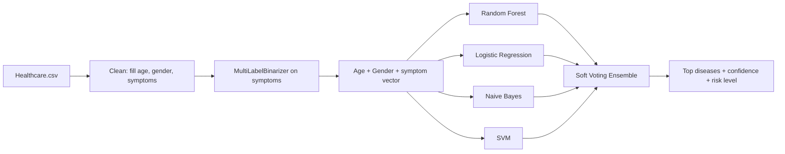
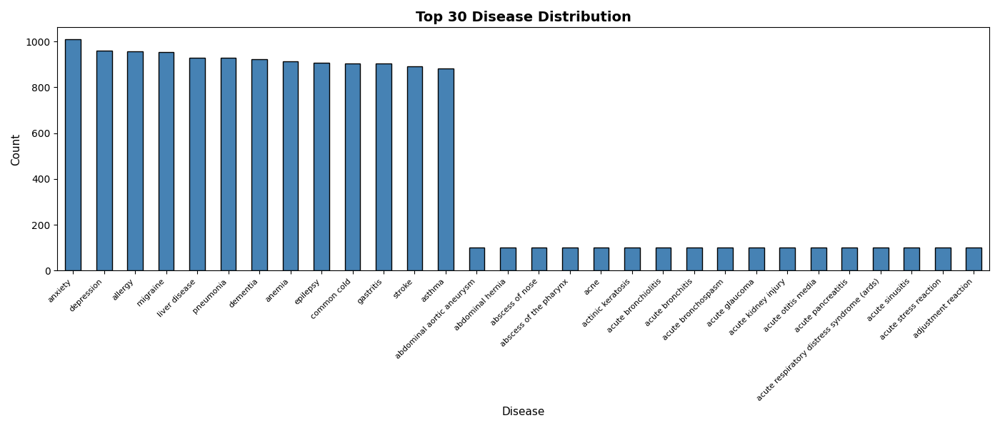
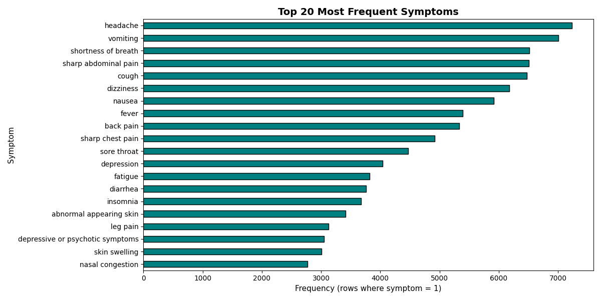
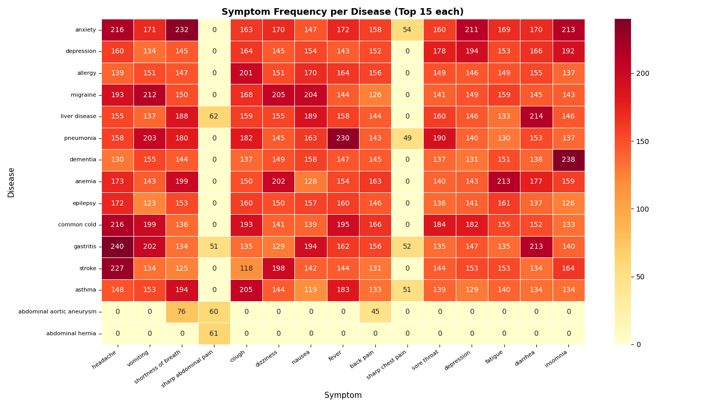
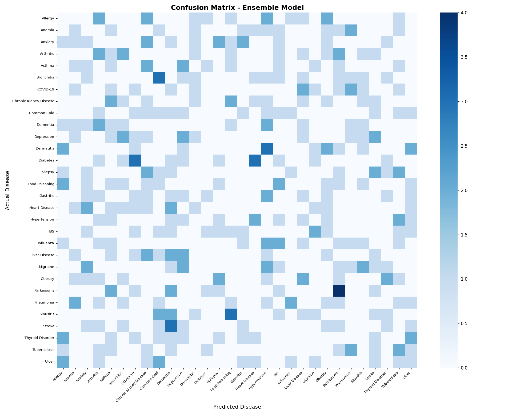

<div align="center">

# 🩺 Disease Prediction System

**Predicting likely diseases from patient symptoms with an ensemble of ML models and a desktop GUI**


</div>

---

## 📌 Overview

The user picks their **symptoms**, **age** and **gender** in a Tkinter app, and the system predicts the most likely diseases with **confidence scores** and a **risk level** (High / Medium / Low).

Behind the GUI is a **soft-voting ensemble** of four classifiers trained on a healthcare dataset, with symptoms one-hot encoded so any combination can be entered.

> ⚠️ **Disclaimer:** This is an academic project. It is not a medical device and must not replace advice from a qualified doctor.

## ✨ Features

- 🧠 **Ensemble learning**: Random Forest + Logistic Regression + Naive Bayes + SVM (soft voting)
- 🖥️ **Desktop GUI**: scrollable symptom checklist, age and gender input
- 📈 **Top predictions** with confidence percentages
- 🚦 **Risk classification**: colour-coded High / Medium / Low
- ⚖️ **Class balancing** (`class_weight="balanced"`) for rare diseases
- 📊 **Model comparison**: accuracy of each model vs the ensemble
- 🔥 **Visual analysis**: disease distribution, top symptoms, symptom–disease heatmap, confusion matrix

## 🔄 How It Works



## 🚦 Risk Levels

| Level | Example diseases |
|---|---|
| 🔴 **High** | Heart Disease, Stroke, Diabetes, Hypertension, Tuberculosis, COVID-19 |
| 🟠 **Medium** | Asthma, Thyroid Disorder, Anemia, Depression, Influenza |
| 🟢 **Low** | Everything else (e.g. Allergy, Common Cold) |

## 📂 Project Structure

```
Disease-Prediction-System/
├── Data/
│   └── Healthcare.csv            # Patient_ID, Age, Gender, Symptoms, Symptom_Count, Disease
├── outputs/                      # Generated charts
├── src/
│   └── disease_prediction.py     # Preprocessing, ensemble training, evaluation, GUI
├── requirements.txt
└── README.md
```

## 🚀 Getting Started

```bash
git clone https://github.com/Gaganajain/Disease-Prediction-System.git
cd Disease-Prediction-System
pip install -r requirements.txt
cd src
python disease_prediction.py
```

The script trains the models, prints each model's accuracy, then opens the GUI.

## 📸 Results

| Disease distribution | Top symptoms |
|---|---|
|  |  |

| Symptom vs disease heatmap | Ensemble confusion matrix |
|---|---|
|  |  |

## 🛠️ Tech Stack

| Area | Tools |
|---|---|
| Language | Python |
| Data | Pandas, NumPy |
| ML | scikit-learn (RandomForest, LogisticRegression, GaussianNB, SVC, VotingClassifier) |
| Visualisation | Matplotlib, Seaborn (charts in `outputs/`) |
| GUI | Tkinter |

## 🔮 Future Improvements

- Web version with Flask or Streamlit
- Explain predictions with SHAP (which symptoms drove the result)
- Larger, clinically validated dataset

## 👩‍💻 Author

**Gagana Jain A** · [GitHub](https://github.com/Gaganajain)

⭐ If you found this useful, consider giving the repo a star!
